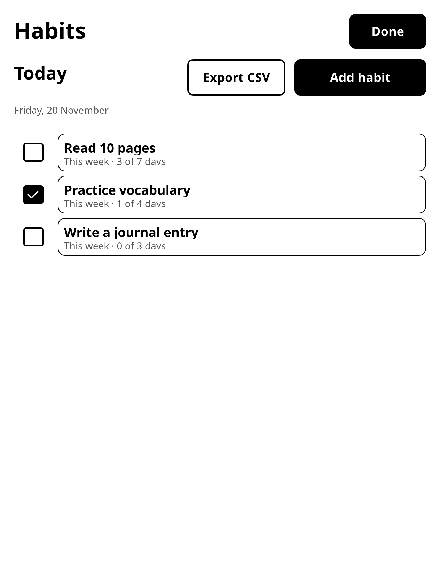
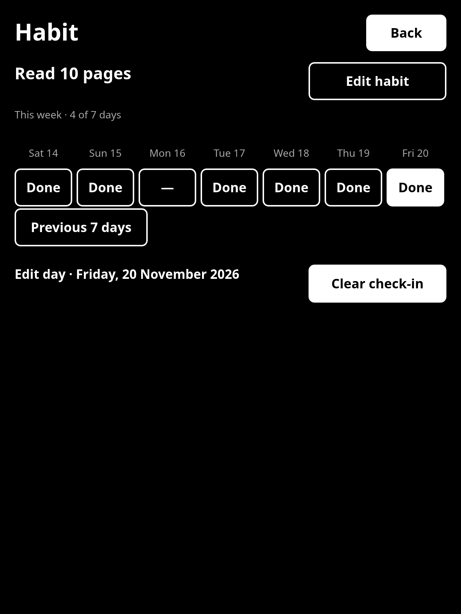
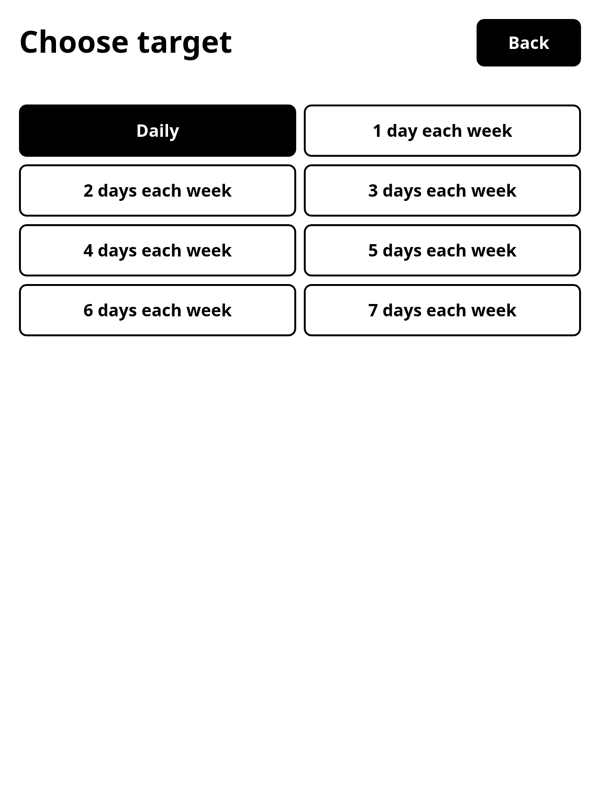

# Habits for Kindle

Log daily routines on Kindle and see how you are doing this week.

<table>
  <tr>
    <td align="center"><br><sub>Habit check-ins for Today</sub></td>
    <td align="center"><br><sub>Seven days of history in dark mode</sub></td>
    <td align="center"><br><sub>Choosing a daily or weekly target</sub></td>
  </tr>
</table>

The screenshots are from the desktop simulator.

## How to use it

- Tap **Add habit** and enter a name. Choose a daily target or a number of days per week.
- Tap an item’s checkbox on **Today** to save a check-in. Tap it again to clear that day.
- Open a habit to see seven labelled dates. Choose a date and use **Mark done** or **Clear check-in** to correct it.
- Tap **Export CSV** to save the history in **Documents** for copying over USB.

Habits and check-ins stay on the Kindle. Weekly totals start on Monday.

## Install

Open **Store** from Primitive Launcher and look for **Habits**. [Install guide](INSTALL.md)

## Simulate on a computer

Keep [PrimitiveOS Tools](https://github.com/PrimitiveOS/kindle-primtitive-tools) and
[Primitive Launcher](https://github.com/PrimitiveOS/kindle-primitive-launcher) beside this repository.

```sh
cargo test --offline --locked --workspace
cargo run --offline --locked -p habits-desktop -- build/previews
```

## Licence

App code is licensed under [PolyForm Noncommercial 1.0.0](LICENSE).
Original artwork, documentation, and screenshots use [CC BY-NC-SA 4.0](LICENSE-DOCS).
Chrono date handling uses the [upstream licence](licenses/chrono-LICENSE.txt).
